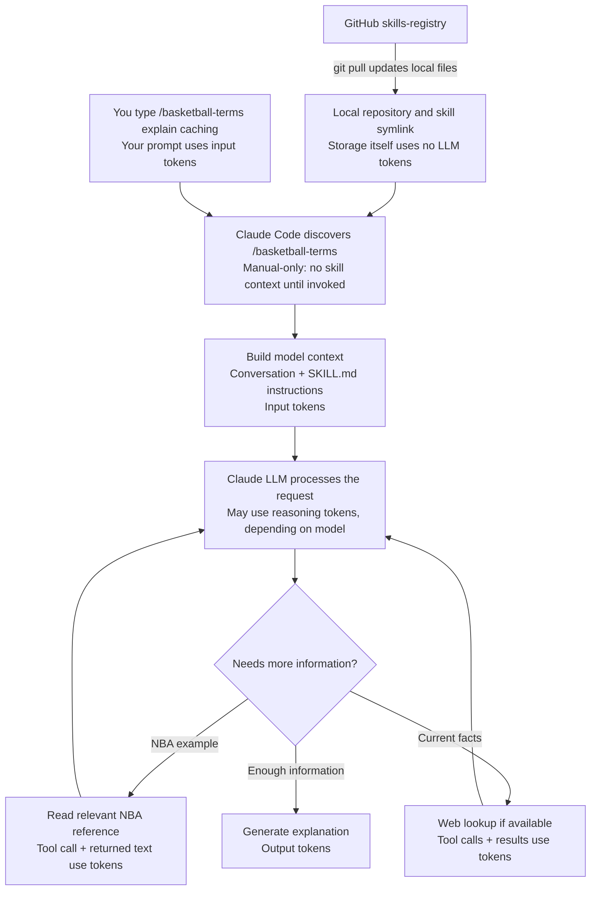
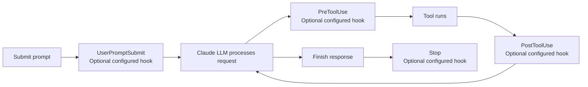

# Basketball Terms: architecture and token usage

This document explains the Claude Code setup published on November 8, 2026. It is documentation for the user and maintainers, not extra instructions to load for every basketball explanation.

## What the skill does

A skill is a reusable set of text instructions for the Claude large language model (LLM). When invoked, this one asks the model to explain an idea simply through basketball, favoring 2010s examples. It uses the existing model in your conversation; it does not train a model or require a separate LLM call just because it is a skill.

Claude Code discovers the local skill through this link:

```text
~/.claude/skills/basketball-terms
  -> /Users/knguyen/Documents/skills-registry/skills/basketball-terms
```

The repo is the maintained copy. GitHub distributes updates, while Claude reads the local files. A GitHub push alone does not update a checkout on another machine.

## Request flow, including the LLM and tokens



`disable-model-invocation: true` makes the Claude Code skill manual-only. Invoke it with:

```text
/basketball-terms explain database indexes
```

The skill's content enters the conversation when invoked. Reference files are available to read as needed; they are not all automatically included. For a simple explanation, the current roster bank, acceptance cases, and this architecture document need not be read. See [Claude skill documentation](https://code.claude.com/docs/en/skills) and [context loading](https://code.claude.com/docs/en/features-overview).

For Codex, the same folder also has `agents/openai.yaml` with `policy.allow_implicit_invocation: false`. Invoke explicitly using `$basketball-terms` or select it through `/skills`. That file configures Codex; the Claude Code manual-only switch is in `SKILL.md`.

## Hooks behind the scenes

The published basketball skill defines no hooks. At inspection on November 8, 2026, the user-level Claude settings contained no hooks, and this repository had no project settings files defining them. This is a snapshot of the inspected setup, not a claim about all other projects, plugins, or managed settings.

A slash command uses Claude Code's built-in skill system. It does not need a custom hook to activate it. Hooks are optional actions attached to lifecycle events:



This is a simplified lifecycle diagram, not an exact execution trace. The hook boxes show available extension points, not hooks installed by this skill. Hooks can run configured scripts or other actions, and prompt or agent hooks can call an LLM. See [Claude hooks documentation](https://code.claude.com/docs/en/hooks).

## What consumes tokens

Tokens are the pieces of text a model reads or generates. File size on disk is not an exact token count.

| Component | LLM token effect |
|---|---|
| Skill files stored locally or on GitHub | No model tokens just for storage |
| Local symlink and command discovery | No skill text in the model context before manual invocation |
| Your prompt and existing conversation | Input tokens when included in a model request |
| Loaded SKILL.md | Adds input context when invoked |
| NBA reference text actually read | Adds input context |
| Tool calls and returned web or file text | Model-generated tool-call text and returned context contribute to usage |
| Local command hook executing a script | Script execution itself needs no LLM tokens |
| Hook returning text to Claude | Returned context contributes input tokens |
| Prompt or agent hook calling an LLM | Additional model calls consume tokens |
| Model reasoning | May consume reasoning tokens, depending on the model |
| Generated explanation | Output tokens |

Conceptually, usage across a request is the sum of the input and generated tokens across all model calls, including any reasoning tokens reported by the model. Reasoning may already be included in reported output totals; do not count it twice. A tool lookup can lead to another model call containing the returned information. Loaded text can also remain in later conversation context, so loading a file once does not mean it is processed only once throughout a chat. Caching and context compaction can affect subsequent processing and billing.

This document does not give an exact token or dollar cost. Those depend on the model, conversation length, files actually read, number of calls, output length, caching, and the product's usage accounting. A word count is only a rough estimate of text size.

## Example: explaining caching

1. You submit `/basketball-terms explain caching`.
2. Claude Code loads the skill instructions into the conversation.
3. The LLM chooses a basketball scenario and may read the historical reference bank.
4. It explains caching and connects the comparison back to the real concept.
5. It can finish without researching current rosters, reading acceptance cases, or running a custom hook.

The skill makes the guidance reusable and consistent. The instructions, any reference text read, and the answer still consume model tokens.
